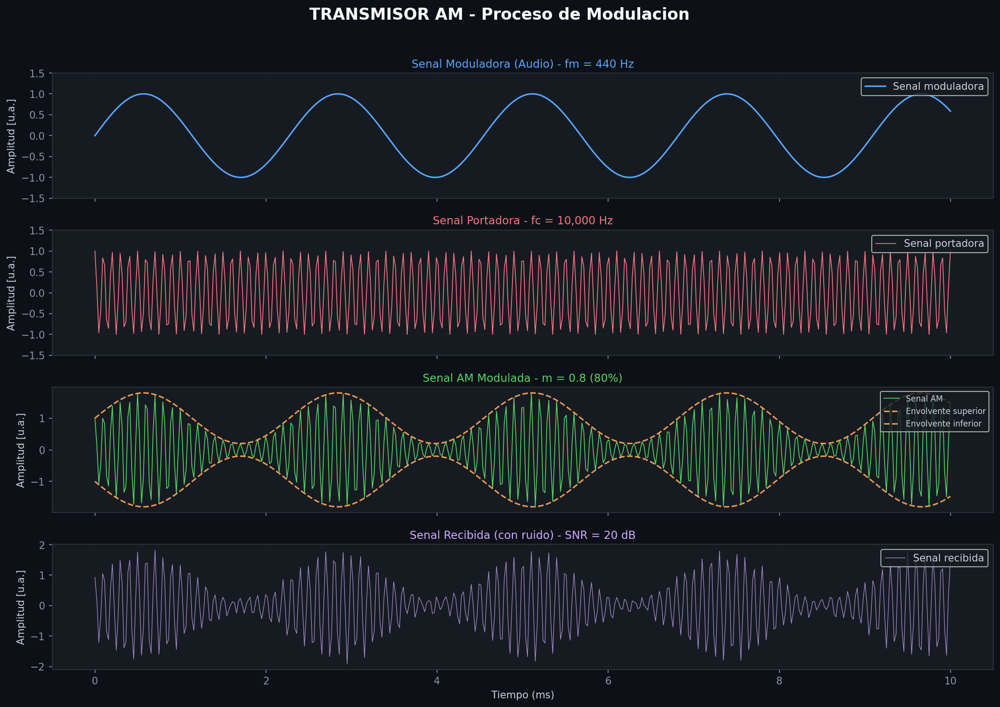
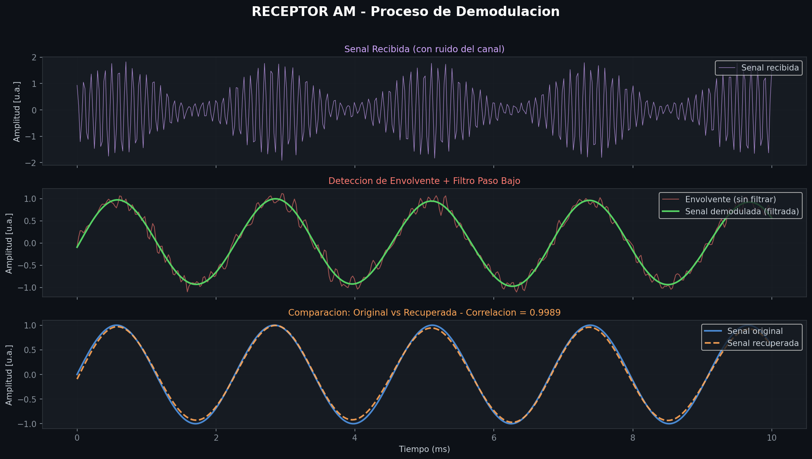
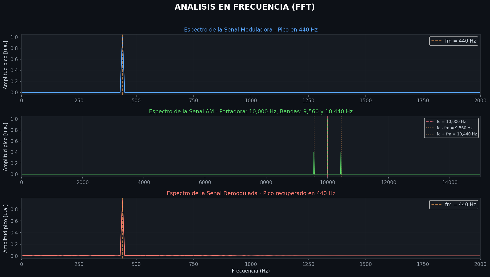
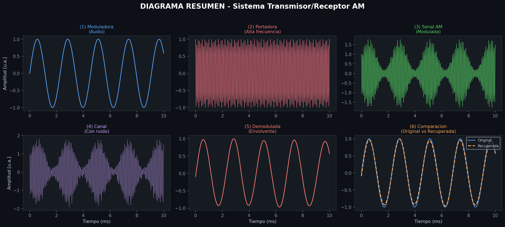
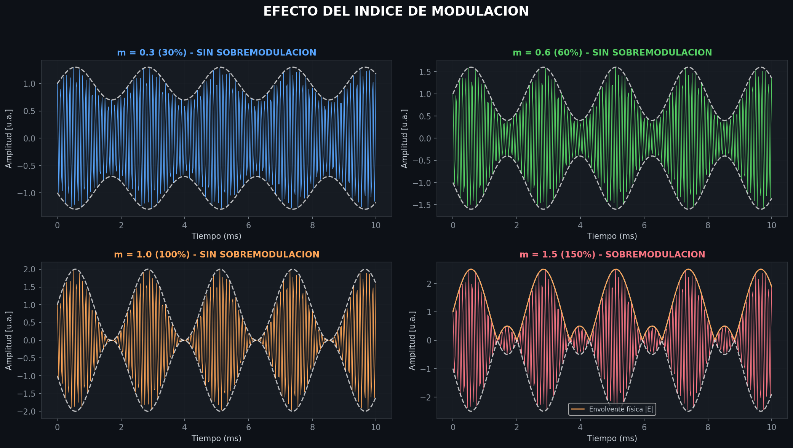

# Transmisor y receptor AM de audio

**Asignatura:** Teoría de Señales — Universidad de Manizales  
**Integrantes:** Juan David Rodriguez 
**Entrega:** Implementación inicial con extensión de recepción y análisis frecuencial.

## 1. Descripción y objetivo

El proyecto simula un sistema de modulación en amplitud con doble banda lateral y portadora transmitida (AM DSB-LC). Un tono de audio de 440 Hz modifica la amplitud de una portadora de 10 kHz. La señal atraviesa un canal con ruido gaussiano y se recupera mediante detección de envolvente y filtrado paso bajo.

El objetivo es relacionar la implementación numérica con muestreo, representación temporal, periodicidad, espectro, ruido y procesamiento de señales. El sistema es una simulación de un tono: no realiza transmisión por antena ni adquisición con micrófono.

## 2. Estado actual

| Etapa | Estado |
|---|---|
| Generación del mensaje y la portadora | Implementada |
| Modulación AM y comparación temporal | Implementada |
| Canal con ruido reproducible | Implementado |
| Detección de envolvente y filtro paso bajo | Implementados, procesamiento fuera de línea |
| Comparación original/recuperada | MSE y correlación después de normalización |
| FFT e índices de modulación | Implementados como ampliación |
| Carga de voz o música, reproducción de audio | Pendientes |
| Receptor causal y validación para distintos escenarios | Pendientes |

## 3. Organización

```text
proyecto-teoria-senales/
├── README.md
├── requirements.txt
├── .gitignore
├── src/
│   └── sistema_am.py
├── data/
│   └── README.md
├── results/
│   ├── grafica_01_modulacion_am.png
│   ├── grafica_02_demodulacion.png
│   ├── grafica_03_espectro_fft.png
│   ├── grafica_04_resumen_sistema.png
│   ├── grafica_05_indices_modulacion.png
│   ├── caracteristicas.csv
│   ├── parametros.json
│   └── metricas.json
└── docs/
    ├── fundamentos.md
    ├── resultados.md
    └── cambios_tecnicos.md
```

El código se organiza en bloques numerados, con funciones auxiliares para el espectro y las características. No se necesita un notebook.

## 4. Procedencia de datos y parámetros

Se generan todas las señales computacionalmente. No hay bases de datos externas ni grabaciones de personas. Las amplitudes se expresan en unidades arbitrarias (u.a.); no se han calibrado voltajes.

| Parámetro | Valor |
|---|---:|
| Frecuencia de muestreo, fs | 44100 Hz |
| Intervalo, Ts = 1/fs | 22.675737 µs |
| Duración del registro | 0.1 s |
| Número de muestras | 4410 |
| Frecuencia del mensaje, fm | 440 Hz |
| Frecuencia de portadora, fc | 10000 Hz |
| Amplitud del mensaje, Am | 1 u.a. |
| Amplitud de portadora, Ac | 1 u.a. |
| Índice de modulación, μ | 0.8 |
| SNR objetivo | 20 dB |
| Semilla del generador de ruido | 2026 |
| Corte del filtro Butterworth | 880 Hz |
| Orden de diseño del filtro | 4 |

La frecuencia superior de la AM ideal es fc + fm = 10440 Hz. Se cumple fs > 2(fc+fm), pues 44100 > 20880 Hz. La justificación considera la señal modulada, no solamente el audio. Hay 4.41 muestras por ciclo de portadora; las líneas que unen muestras en las figuras son una ayuda visual, no una reconstrucción analógica exacta.

## 5. Ejecución

Entorno comprobado: Python 3.12.14, NumPy 2.3.5, SciPy 1.17.0 y Matplotlib 3.10.8. Se recomienda Python 3.12 para reproducirlo.

### 5.1. Requisitos previos

Se necesita Python instalado. Visual Studio Code es un editor opcional y no sustituye a Python.

Para comprobar la instalación, abre una terminal y ejecuta:

```powershell
python --version
```

En Windows, si ese comando no se reconoce, prueba:

```powershell
py --version
```

Si ninguno funciona, instala Python desde https://www.python.org/downloads/. Si el instalador presenta la casilla **Add python.exe to PATH**, actívala. Después de instalar, cierra y vuelve a abrir la terminal y Visual Studio Code.

### 5.2. Descargar y abrir el proyecto

1. Descarga el archivo ZIP y selecciona **Extraer todo**.
2. Abre la carpeta extraída `proyecto-teoria-senales`.
3. Comprueba que contiene `README.md`, `requirements.txt` y las carpetas `src`, `data`, `docs` y `results`.

Para trabajar desde Visual Studio Code:

1. Abre Visual Studio Code.
2. Selecciona **File → Open Folder** (Archivo → Abrir carpeta).
3. Selecciona la carpeta `proyecto-teoria-senales`.
4. Abre **Terminal → New Terminal** (Terminal → Nueva terminal).

También puedes abrir una terminal directamente desde la carpeta del proyecto, sin utilizar Visual Studio Code.

### 5.3. Instalar las dependencias

La terminal debe estar ubicada en la carpeta que contiene `requirements.txt`. En Windows puedes comprobarlo con:

```powershell
dir
```

Instala las librerías ejecutando:

```powershell
python -m pip install -r requirements.txt
```

Espera a que termine la instalación. Se requiere conexión a Internet para descargar las dependencias.

Si tu equipo utiliza `py`, ejecuta:

```powershell
py -m pip install -r requirements.txt
```

### 5.4. Ejecutar el programa

Si modificaste el código, guarda los cambios con **Ctrl + S**. Después ejecuta:

```powershell
python src/sistema_am.py
```

Si utilizaste `py` para instalar las dependencias:

```powershell
py src/sistema_am.py
```

No se requiere una compilación manual: Python ejecuta el archivo.

Se abrirán las cinco figuras y los resultados se guardarán en `results`. Cierra las ventanas de las figuras para que el programa termine.

Para guardar los resultados sin abrir ventanas:

```powershell
python src/sistema_am.py --sin-ventanas
```

### 5.5. Consultar los resultados

La carpeta `results` contiene:

- Cinco figuras en formato PNG.
- `caracteristicas.csv`: características numéricas de las señales.
- `parametros.json`: parámetros y versiones utilizadas.
- `metricas.json`: SNR, error cuadrático medio y correlación.

Las rutas de salida se calculan respecto al archivo del programa. Cada ejecución sobrescribe sus resultados anteriores.

Para visualizar el README con sus imágenes en Visual Studio Code, abre `README.md` y presiona **Ctrl + Shift + V**.

### 5.6. Solución de problemas frecuentes

| Mensaje o problema | Qué revisar |
|---|---|
| `python` no se reconoce | Probar `py --version`; si tampoco funciona, instalar Python y reiniciar la terminal. |
| No se encuentra `requirements.txt` | Abrir la terminal dentro de `proyecto-teoria-senales`. |
| `ModuleNotFoundError` | Instalar las dependencias con el mismo intérprete utilizado para ejecutar el programa. |
| No se encuentra `src/sistema_am.py` | Verificar que se extrajo todo el ZIP y que la terminal está en la carpeta principal. |
| La terminal no vuelve a mostrar el cursor de comandos | Cerrar las ventanas de las figuras; el programa espera mientras permanecen abiertas. |

## 6. Conceptos utilizados

El mensaje y la portadora son:

$$x(t)=A_m\sin(2\pi f_mt),\qquad c(t)=A_c\cos(2\pi f_ct).$$

Con el mensaje normalizado, la modulación es:

$$s(t)=A_c\left[1+\mu\frac{x(t)}{A_m}\right]\cos(2\pi f_ct).$$

En el código, `m` representa μ. Es un parámetro independiente; no se calcula como Am/Ac. Con μ=0.8, la envolvente ideal positiva varía entre 0.2 y 1.8 u.a. La frecuencia del oscilador portador permanece fija mientras cambia su amplitud.

Los períodos continuos son Tm=2.272727 ms y Tc=0.1 ms. La AM ideal tiene período fundamental 25 ms. Las muestras se toman en t=n/fs, sin incluir el extremo final: el último instante es 0.099977324 s. El ruido hace que la señal recibida no sea periódica. Se estudia un registro finito de señales ideales periódicas.

La detección usa el módulo de la señal analítica obtenida con Hilbert [1], elimina la media y aplica un Butterworth de orden 4 mediante `filtfilt`. Este último filtra hacia adelante y hacia atrás: tiene fase cero y orden combinado 8, y requiere el registro completo [2]. No es un receptor en tiempo real.

La explicación matemática y las condiciones de comparación aparecen en [fundamentos](docs/fundamentos.md).

## 7. Resultados actuales

### Transmisión y ruido



Se muestran los primeros 10 ms: el mensaje realiza 4.4 ciclos y la portadora 100. La AM conserva oscilaciones rápidas cuyos límites siguen el mensaje. El canal añade irregularidades, manteniendo visible la estructura de la modulación. Las envolventes del transmisor se calculan desde el mensaje conocido.

### Recuperación



La envolvente detectada contiene ruido; el filtro reduce sus variaciones rápidas. La señal recuperada sigue de cerca al mensaje. Para comparar amplitudes se multiplica por un factor basado en el pico del mensaje original: las métricas corresponden a esa señal normalizada y no demuestran recuperación absoluta de ganancia.

| Medida | Registro completo | Interior: 0.01 ≤ t < 0.09 s |
|---|---:|---:|
| MSE [u.a.²] | 0.00256643 | 0.00231022 |
| Correlación | 0.99889805 | 0.99913630 |

SNR objetivo: 20 dB; medida: 19.93383265 dB. El ruido aleatorio finito no tiene exactamente la potencia esperada. La comparación interior excluye 10 ms por borde como diagnóstico de efectos de extremos, sin garantizar que todos los efectos desaparezcan.

### Frecuencia



La FFT calcula la DFT de las muestras. El eje horizontal está en Hz y el vertical en amplitud pico unilateral, no en potencia ni dB. Se observan 440 Hz en el mensaje y 9560, 10000 y 10440 Hz en la AM, con amplitudes ideales 0.4, 1 y 0.4. El espectro recuperado concentra su componente dominante cerca de 440 Hz.

Se usa ventana rectangular y separación entre bins fs/N=10 Hz. El registro contiene números enteros de ciclos de los tonos de transmisión; por ello sus frecuencias coinciden con bins. Una grabación arbitraria puede presentar fuga espectral. Se divide el módulo de la DFT por N y se duplican solo los bins interiores, sin duplicar DC ni Nyquist [3].

### Resumen e índice de modulación



Los seis paneles reúnen las etapas del procesamiento y la comparación final.



Los índices 0.3 y 0.6 dejan una envolvente positiva; μ=1 alcanza idealmente cero. Con μ=1.5 el factor de amplitud cambia de signo: las curvas blancas son el factor firmado y su opuesto, mientras la curva naranja muestra su módulo. La detección de envolvente pierde ese signo y produce distorsión por sobremodulación. En una malla discreta el mínimo exacto puede no coincidir con una muestra.

Las características completas están en [caracteristicas.csv](results/caracteristicas.csv); la interpretación ampliada está en [resultados](docs/resultados.md).

## 8. Limitaciones y continuación

Esta ejecución valida un caso sintético de corta duración. No establece desempeño para voz, música, múltiples semillas, interferencias o un receptor físico. La normalización requiere conocer el pico del mensaje original. El filtro a 880 Hz se eligió para este tono, no para todo el ancho de banda de audio.

La integración final contempla carga de audio, definición de su ancho de banda, evaluación con varios niveles de ruido, calibración de ganancia independiente del mensaje y estudio de filtrado causal. Las técnicas de Hilbert, filtrado y FFT son ampliaciones de la implementación inicial.

## 9. Referencias técnicas en inglés

Consultadas el 10 de octubre de 2026.

1. SciPy, *hilbert*: señal analítica y extracción de envolvente. https://docs.scipy.org/doc/scipy/reference/generated/scipy.signal.hilbert.html
2. SciPy, *filtfilt*: filtrado hacia adelante y atrás y tratamiento de extremos. https://docs.scipy.org/doc/scipy/reference/generated/scipy.signal.filtfilt.html
3. NumPy, *numpy.fft.rfft*: DFT de entrada real. https://numpy.org/doc/stable/reference/generated/numpy.fft.rfft.html
4. MathWorks, *Amplitude Modulation*: descripción y variantes de AM. https://www.mathworks.com/help/comm/ug/amplitude-modulation.html
